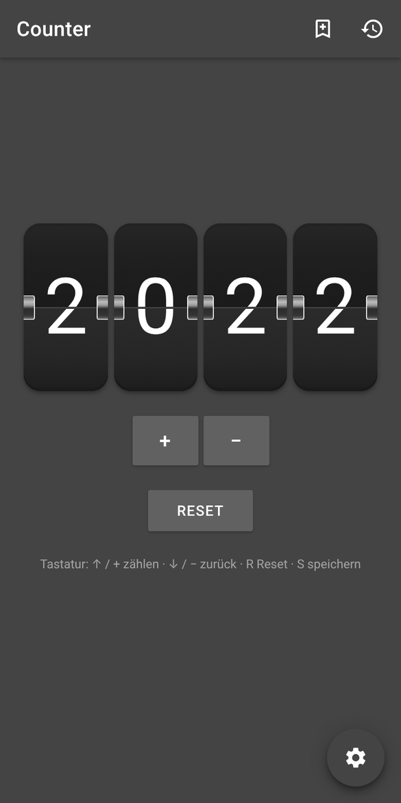
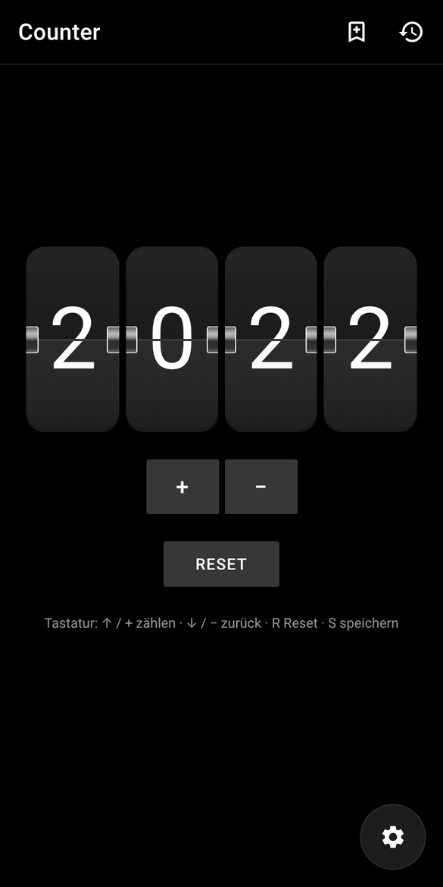
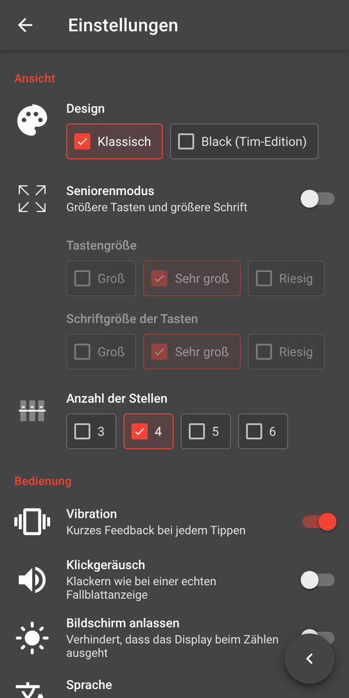

<p align="center">
  
</p>

<h1 align="center">Counter</h1>

<p align="center">
  Ein Zähler im Rolodex-/Flip-Clock-Design.<br>
  <sub>2021 als Android-App mit Sketchware gebaut – 2026 als Web-App zurückgeholt.</sub>
</p>

<p align="center">
  
  
  
  <a href="LICENSE"></a>
</p>

<p align="center">
  
  &nbsp;
  
  &nbsp;
  
</p>

---

## Nostalgie – Revived

Counter war eine meiner ersten Apps: Plus, Minus, Reset und vier Fallblatt-Ziffern, zusammengeklickt in
[Sketchware](https://sketchware.pro/). Auf der Ideenliste standen damals noch viel mehr Sachen –
Ergebnisse speichern, ein richtiger Seniorenmodus, eine Info-Seite wie bei WhatsApp oder Hauk, ein Spenden-Button …
fertig geworden ist davon wenig.

Die **Web-Edition** holt das Original-Design zurück, behebt die alten Bugs und bringt endlich die Funktionen
mit, die ich mir damals vorgenommen hatte.

## Funktionen

- **Zählen wie früher** – Fallblatt-Animation, die Ziffern kaskadieren beim Reset wie in der App
  (und die Easter-Eggs bei 9999 → 0 sind noch da)
- **Ergebnisse speichern** – mit Namen sichern, wieder laden, umbenennen, löschen, als CSV exportieren
- **Seniorenmodus** – Tastengröße und Schriftgröße per Kästchen wählbar, die sich gegenseitig abwählen
- **Black-Design** – die Sonderversion für Tim von 2022, jetzt zum Umschalten ([mehr dazu](#-die-black-version))
- **3 bis 6 Stellen**, Taste gedrückt halten zum schnellen Zählen, Tastatur-Steuerung
- **Vibration, Klickgeräusch** und „Bildschirm anlassen“ beim Zählen
- **App-Info-Seite** mit Changelog, Danksagungen und Lizenzen, optionaler **Spenden-Button**
- **Offline-fähig & installierbar** als App auf Handy und Desktop
- **Deutsch & English**, automatisch nach Browsersprache
- **Datenschutzfreundlich** – keine Tracker, keine externen Dienste, Schrift lokal; alles bleibt im Browser

## Web-Version veröffentlichen

Die Web-App liegt komplett in [`web/`](web) – reines HTML/CSS/JS, kein Build-Schritt.

**Cloudflare Pages:** *Workers & Pages → Create → Pages → Connect to Git* → dieses Repo →
Production branch `main`, Build command leer, **Build output directory `web`**.
Jeder Push auf `main` geht dann automatisch online.

Links (Spenden, Website, Impressum) werden in [`web/config.js`](web/config.js) eingestellt.
Mehr Details stehen in [`web/README.md`](web/README.md).

Lokal ausprobieren:

```bash
cd web && python3 -m http.server 8000
```

## 🖤 Die Black-Version

Anfang 2022 ist für **[Tim Trayler](https://github.com/TimTrayler)** eine komplett schwarze Sonderversion
entstanden (Tag `BLACK`, Branch [`black`](../../tree/black)) – Tim hat dafür auch selbst die schwarze
Statusleiste beigesteuert. In der Web-Edition ist sie jetzt unter *Einstellungen → Design → Black (Tim-Edition)*
mit denselben Farben wieder da. Danke, Tim!

## 🔁 Back from Zero

Counter ist Teil von **Back from Zero** – meinem Projekt, alte Sachen aus der *byZero*-Zeit
wieder zum Laufen zu bringen: aufräumen, Bugs fixen, modernisieren, und endlich fertig bauen,
was damals liegen geblieben ist.

| Projekt | Status |
| --- | --- |
| **[Counter](https://github.com/EinfachRuwen/Counter)** | ✅ zurück – als Web-App im Original-Design |
| **[ZeroBot](https://github.com/EinfachRuwen/ZeroBot)** | 🔧 in Arbeit |
| **[WebsiteGenerator](https://github.com/WebsiteGenerator/WebsiteGenerator)** | 🔧 in Arbeit |

## Die Original-App (Android)

Der Sketchware-Quellcode der Android-App liegt unverändert in [`src/`](src), die Store-Texte und
Screenshots in [`fastlane/`](fastlane). Alte APKs gibt es unter [Releases](../../releases).

## Projektstruktur

```
web/        Web-Edition (wird veröffentlicht)
src/        Android-App (Sketchware-Export, 2021–2022)
brand/      Logos, Banner, Screenshots
fastlane/   Store-Metadaten der Android-App (F-Droid / IzzyOnDroid)
```

## Danke

- **[Tim Trayler](https://github.com/TimTrayler)** – Black-Version und schwarze Statusleiste
- **[IzzySoft](https://github.com/IzzySoft)** – fastlane-Struktur für F-Droid / IzzyOnDroid
- **[ImgBot](https://imgbot.net/)** – Bildoptimierung

## Mitmachen

Ideen, Bugs und Feature-Wünsche gerne als [Issue](../../issues). Wenn dir Counter gefällt, lass einen ⭐ da.

## Lizenz

Copyright © 2021–2026 byZero · [MIT](LICENSE)<br>
Schrift Roboto: Apache License 2.0
